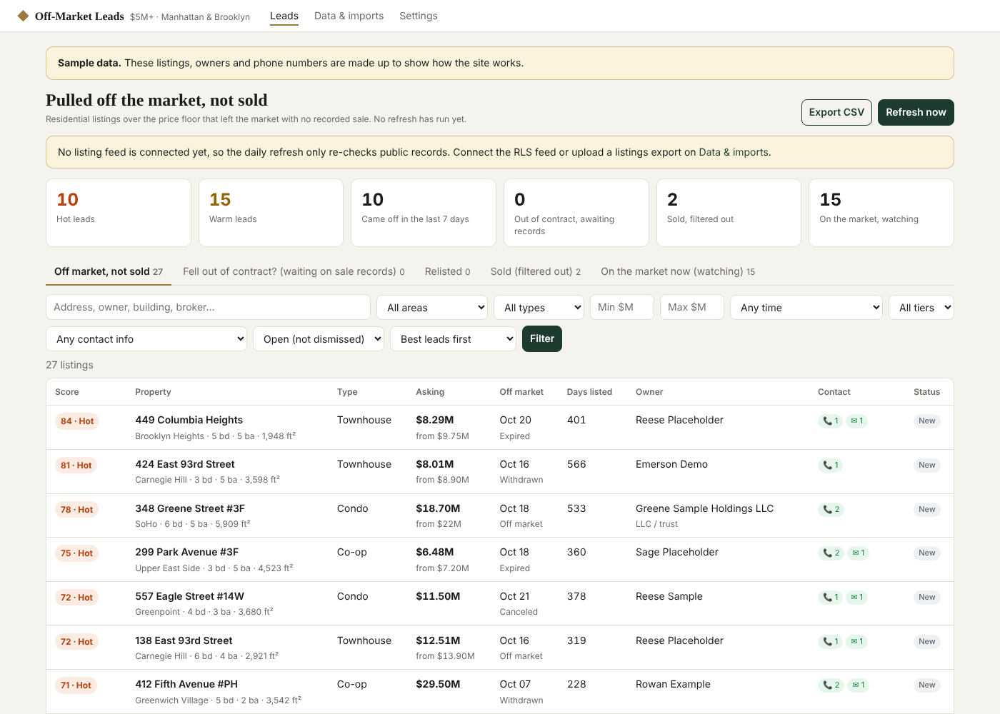

# Off-Market Luxury Leads

A website that finds **Manhattan and Brooklyn residential listings over $5M that came off the market without
selling**, names the owner of record, and (with a skip-trace key) their phone and email, refreshed every
morning at 6am New York time.



## How it decides what's a lead

1. **Listings in.** Every morning it pulls every $5M+ residential listing (condo, co-op, townhouse, house,
   2–4 family) from the listing feed, plus every status change since yesterday. Manhattan is all in; Brooklyn is
   limited to the neighborhoods on the Settings page (default: Brooklyn Heights, DUMBO, Cobble Hill, Carroll
   Gardens, Boerum Hill, Park Slope, Prospect Heights, Fort Greene, Clinton Hill, Williamsburg, Greenpoint).
   Listings that started above $5M and were cut below it are kept.
2. **Came off the market.** A listing becomes a candidate when its status turns Expired, Withdrawn, Canceled or
   Temporarily Off Market, or when it disappears from the active feed for 2 days.
3. **Sold ones are dropped.** Closed in the feed → sold. Otherwise the unit is looked up in **ACRIS** (deeds for
   condos/townhouses; RPTT filings for co-op share transfers) and **DOF rolling sales**. A transfer dated after
   the listing date for at least 50% of the asking price = sold, even if it sold quietly after delisting. Pulled
   listings are re-checked daily for a year because deeds record 1–6 weeks after closing.
   Listings that were **in contract** and then left the market wait 120 days for a deed before becoming a lead.
4. **Relisted ones are set aside.** If the unit comes back on the market (same or another broker), the old
   record moves to Relisted and the new listing remembers how many times it failed to sell.
5. **Owner.** Grantee(s) on the most recent ACRIS transfer for the unit, with the mailing address on the deed.
   For co-ops without a transfer record, the debtor on the latest UCC1. LLC owners are looked up in NY DOS
   corporation records (process address, CEO, registered agent).
6. **Contact.** BatchData skip trace by property address: phones with Do Not Call and TCPA-litigator flags, and
   emails. Manual per lead, or automatic for chosen tiers. Your own do-not-contact list (NY DOS cease-and-desist
   owners, opt-outs) strikes matches out everywhere.
7. **Score (Hot / Warm / Watch).** Price, how recently it came off, expired vs withdrawn, days on market, price
   cuts, prior failed listings, fell out of contract, individual vs LLC owner, callable contact. Every point is
   shown on the lead page.

Each lead page has the listing history, the ACRIS documents behind the sold check (with links to the scans),
the owner, contacts, notes/status, and a printable owner letter (template, or Claude-written with a key).

## Where listings come from

| Source | Status | Notes |
|---|---|---|
| **REBNY RLS feed** (RESO Web API via Trestle) | Built, needs credentials | The NYC listing service behind StreetEasy and brokerage sites. A "Back Office" feed includes expired/withdrawn statuses; an IDX feed only has actives (disappearances are detected instead). Apply via REBNY RLS "Direct Data License" or a pre-licensed vendor; fees are quoted after review. |
| OneKey MLS or another MLS | Same adapter | Set `RESO_*` to that MLS's Web API. |
| Spreadsheet import | Works now | Upload an export from RLS / Perchwell / OneKey / CRM on *Data & imports* (status export, or a full "everything active today" snapshot). |
| StreetEasy, Zillow, Realtor.com, Redfin, Compass | **Not scraped** | Their terms prohibit automated collection and they block bots; their luxury inventory comes from RLS anyway. |

Public records (ACRIS, DOF sales, NY DOS, NYC GeoSearch) are free and need no key.

## Run it

```bash
pip install -r requirements.txt
cp .env.example .env            # add feed credentials / keys
python -m offmarket serve       # website on http://localhost:8000 + daily 6am refresh
python -m offmarket run         # refresh now (cron-friendly)
python -m offmarket import export.csv [--snapshot]
python -m pytest -q             # end-to-end tests with fixture records
```

Try it with fake data: `DATABASE_URL=sqlite:////tmp/demo.db DEMO=1 python -m offmarket demo` then `serve` with the same env.

## Hosting

Needs an always-on machine with outbound internet to the feed, `data.cityofnewyork.us`, `data.ny.gov` and
`geosearch.planninglabs.nyc`. Deploy the Dockerfile (Render, Railway, Fly.io or a small VPS) with a Postgres
`DATABASE_URL` and `DASHBOARD_PASSWORD`. Use an always-on plan so the 6am job runs; or set `ENABLE_SCHEDULER=0`
and call `scripts/run_daily.sh` from the host's scheduler.

## Compliance

Phones flagged Do Not Call or TCPA are never counted as callable. Your firm still needs its own National DNC
registry subscription (SAN) for cold calling, and must honour NY DOS cease-and-desist lists for any zone you
solicit in (the only active Brooklyn zone found in Oct 2026 research is CD 17, East Flatbush). Mail to the
deed address is the lowest-risk first touch.

## Layout

```
offmarket/
  sources/   reso.py (RESO Web API feed), csv_import.py, base.py (status/type normalisation)
  public/    acris.py (deeds, co-op transfers, owners), records.py (DOF sales, GeoSearch, NY DOS)
  enrich/    skiptrace.py (BatchData), letter.py (owner letter)
  pipeline.py   daily job: feed -> off-market detection -> sold check + owner -> skip trace -> score
  settings.py   price floor, neighborhoods, rules (edited on the Settings page)
  scoring.py, compliance.py, web/ (FastAPI site)
tests/
```
